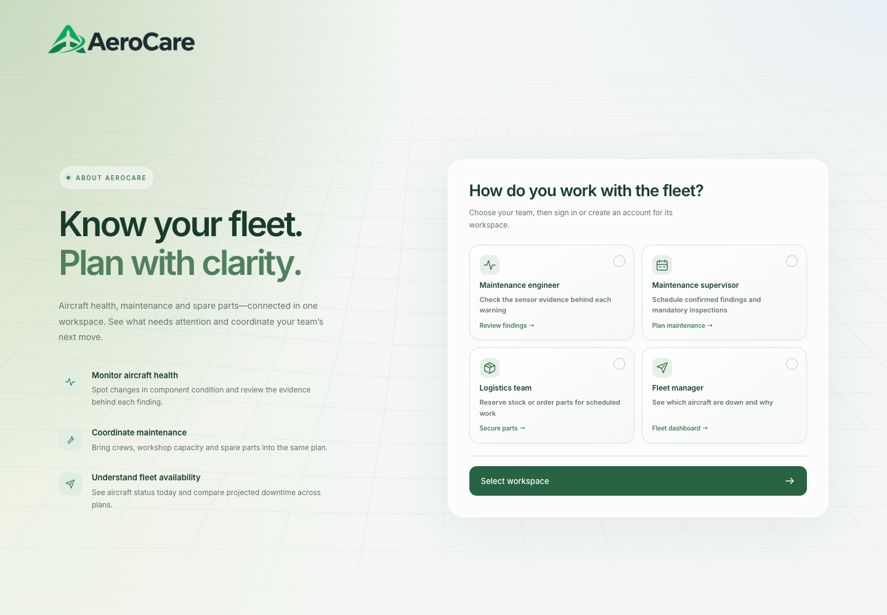
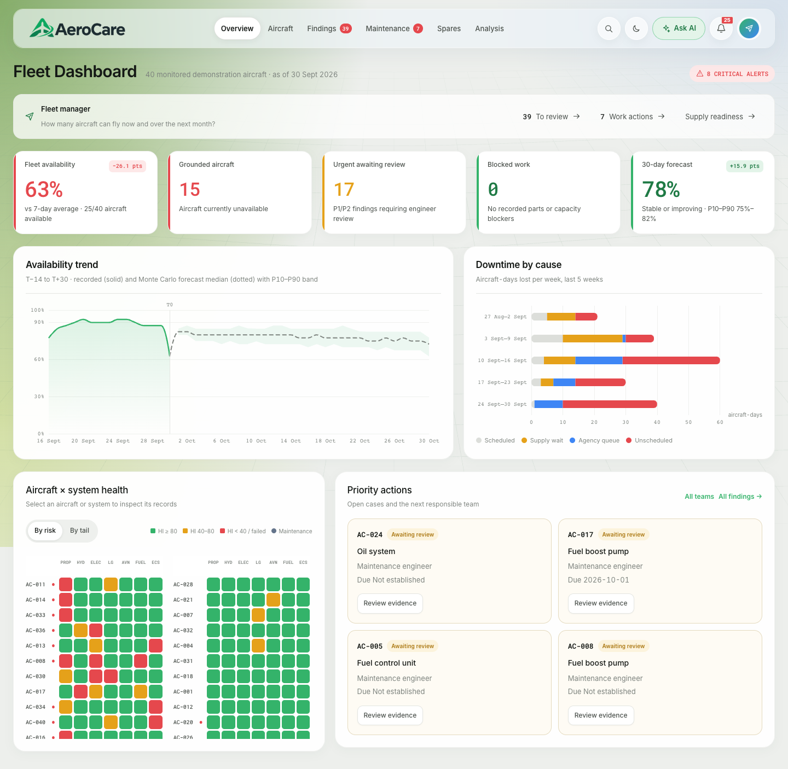
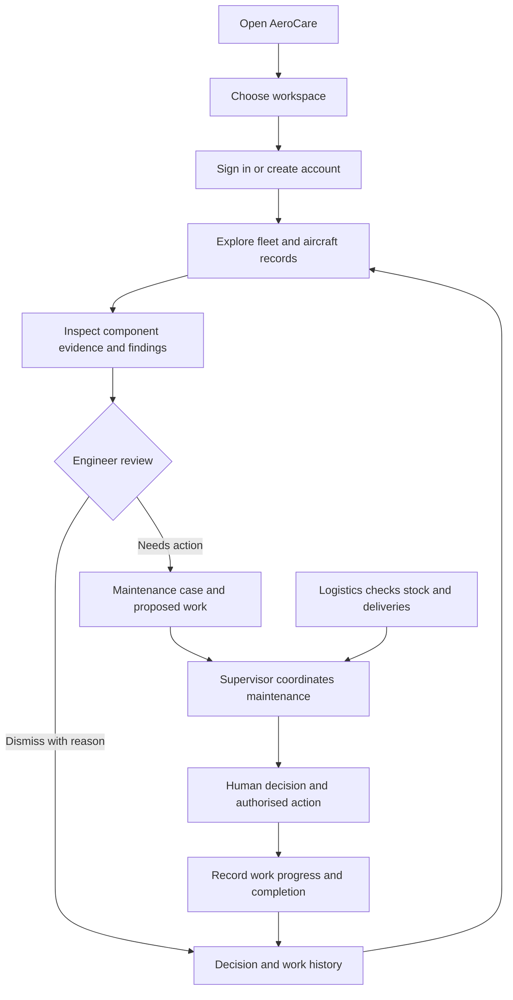
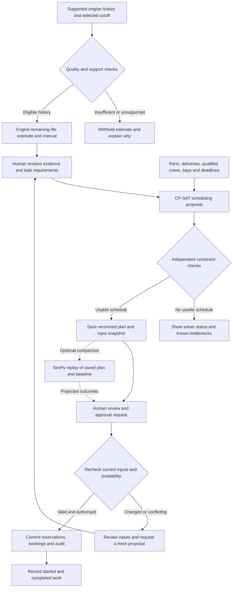
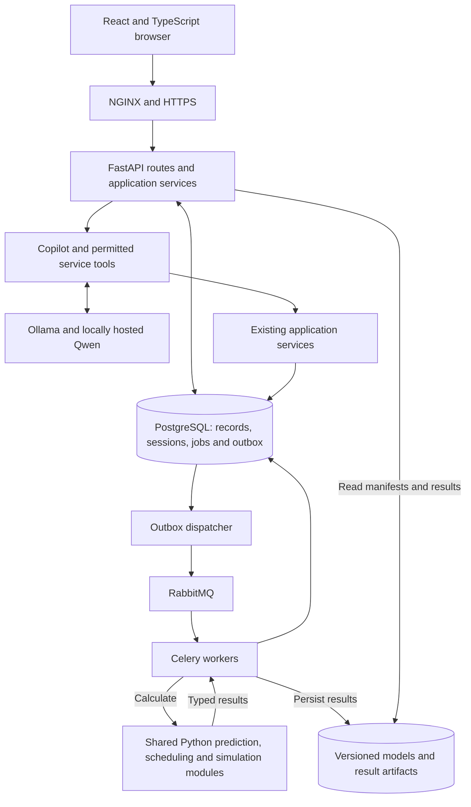

# AeroCare — SIH26249 Aircraft Predictive Maintenance & Fleet Availability

**Connect aircraft health evidence to maintenance decisions, spare parts and fleet availability.**

[](https://github.com/pallavpushkar3-gif/sih-project/actions/workflows/web-checks.yml)
[](https://github.com/pallavpushkar3-gif/sih-project/actions/workflows/backend-checks.yml)
[](docs/product/problem_statement.md)

**[Live application](https://sih-34-56-39-7.sslip.io/)** · **[Video demonstration](https://www.youtube.com/watch?v=HlYxblGJHEs)** · **[Capability and verification index](docs/product/capability_evidence.md)** · **[Evaluation evidence](docs/research/release_evaluation.md)** · **[Local setup](docs/operations/local_setup.md)**

Maintained by **[Team Null Paradox](docs/team/team_null_paradox.md)**.

AeroCare is a working prototype for **Smart India Hackathon SIH26249 / PS26249 — Air Power: Predictive Maintenance & Fleet Availability**. It brings aircraft records, findings, maintenance cases, spares and decision history into one workspace. A separate engine-research workflow estimates remaining useful life, checks resource-constrained schedules and compares simulated outcomes.

The demonstration uses **synthetic fleet and logistics records** and **public simulated engine data**. Benchmark results apply to their stated datasets. AeroCare supports engineering judgement and human approval; it does not provide airworthiness or dispatch clearance.

## Explore the product



1. Open **[AeroCare](https://sih-34-56-39-7.sslip.io/)** and select a workspace.
2. Choose **Maintenance engineer**, **Maintenance supervisor**, **Logistics team** or **Fleet manager**.
3. Select **Sign in** or **Create account**. The chosen workspace stays with the account flow.
4. Open the relevant findings, maintenance, supply or fleet dashboard.

The public installation is a **shared synthetic demonstration**: its explicit demo policy supports signup and login across the four workspaces, including accounts created before the workspace-login correction. Use demonstration information only. Normal production configuration keeps self-registration read-only and requires assigned staff access. [Access policy →](docs/engineering/permissions.md)



*Current product screens, captured from the deployed synthetic demonstration. The interactive aircraft view is illustrative; it is not a validated physical digital twin.*

## Dashboard gallery and walkthrough

Explore the [screen gallery](docs/design/product_gallery.md), including mobile and dark-mode
captures, [annotated maintenance walkthrough](docs/design/maintenance_walkthrough.md), and
[Ask AI recording](docs/design/recordings/ask-ai-record-answers.webm).
The [dated verification summary](docs/team/demo_verification_2026-10-21.md) identifies local versus
historical captures, direct record answers versus generative inference, and remaining proof gaps.
These presentation assets are not a new public-deployment acceptance claim.

## Why AeroCare

Identifying a possible component failure does not, by itself, make maintenance executable. A team also needs supporting evidence, an available spare, qualified people, workshop capacity and an accountable decision.

AeroCare connects those responsibilities so users can follow **what needs attention, why it matters, what blocks the work and what happened after completion**. Its contribution is the traceable workflow from evidence to action.

| Workspace | Main responsibility | What users can inspect or do |
|---|---|---|
| Maintenance engineer | Review the evidence | Inspect component history, sensor trends and findings; confirm or dismiss concerns with a reason |
| Maintenance supervisor | Coordinate maintenance | Review cases, organise work and follow approval and completion records |
| Logistics team | Secure the required parts | Inspect inventory, shortages, parts requests, expected arrivals and receipts |
| Fleet manager | Understand fleet availability | Review aircraft states, maintenance priorities and labelled what-if projections |

## Connected maintenance workflow

The fleet workspace connects aircraft, component evidence, findings, cases, work and supply. Existing record context follows the handoff between teams.



## Two connected areas, distinct evidence

| Area | Data and calculations | Boundary |
|---|---|---|
| **Fleet operations** | Synthetic aircraft/component histories, condition findings, maintenance cases, parts requests and fleet-availability projections | Demonstrates the team workflow; its fleet models and projections are not operational aircraft validation |
| **Engine research and guided trials** | NASA C-MAPSS histories, cutoff-bound remaining-life estimates, calibrated intervals, CP-SAT proposals and saved-plan simulation | Research records have their own datasets, units and cutoffs; the FD001 benchmark belongs to this engine-life workflow |

The research planner and fleet maintenance board have different responsibilities. Do not interpret every fleet-board action as a CP-SAT solve, or FD001 prediction scores as validation of the entire fleet demonstration.

### Engine evidence → checked plan → reviewed work



Prediction intervals communicate evaluated uncertainty; they are not individual engine failure probabilities. The planner preserves hard constraints and distinguishes feasible, optimal, infeasible and unknown solver outcomes. Scenario results never silently change a live plan.

## Main capabilities

- **Fleet and component inspection:** searchable records, linked findings, sensor history, replay context and five illustrative aircraft families, with blueprint/2D and unavailable-WebGL fallbacks.
- **Remaining useful life and uncertainty:** supported engine estimates with dataset, cutoff, transformation, model and calibration provenance.
- **Evidence and data-quality controls:** explicit missing, stale, unsupported and withheld states; model-input sensitivities are not mechanical diagnoses.
- **Maintenance cases and work records:** review, responsibility, linked evidence, supply dependencies and completion history.
- **Research scheduling:** OR-Tools CP-SAT with independent checks for task windows, qualifications, resource capacity, commitments, parts and deadlines.
- **Inventory and approval:** current-input checks, transactional stock/resource reservations and auditable decisions.
- **What-if analysis:** synthetic fleet forecasts and separate saved-plan scenario comparisons with visible assumptions and units.
- **Durable calculations:** Celery/RabbitMQ jobs with outbox dispatch, attempt tracking, retries, cancellation and stale-result handling.
- **Qwen copilot:** conversational access to permitted records and services, with source links and answer checks.

### Implemented workflows worth trying

| Workflow | What is implemented | Where to inspect it |
|---|---|---|
| **Add your aircraft and records** | Register an aircraft and installed components; preview and import usage, technical history and mandatory requirements. Unassessed aircraft remain separate from the scored demo fleet. | Aircraft → Add aircraft; [onboarding contract](docs/engineering/aircraft_registration.md) |
| **Follow a case from input to completed work** | Enter supported engine history and logistics assumptions, calculate evidence and a schedule, compare the saved plan, record a receipt/replan, approve, complete and verify the demo inspection. | Guided trial at `/demo`; [trial walkthrough](docs/product/customer_trial.md) |
| **Replay telemetry through the actual pipeline** | Transport archived FD001 cycles over authenticated HTTP; validate order, duplicates and freshness; create immutable assessment snapshots and follow their mapped visual evidence. | Data & integrations → live replay; [telemetry contract and verification](docs/engineering/live_telemetry_demo.md) |
| **Inspect research beyond FD001** | Separate FD002–FD004 evaluations with declared splits, withheld short histories, calibration and reproduced artifact hashes. These do not expand the selected FD001 serving model's qualification. | Research benchmarks; [multi-subset protocol and results](docs/research/multidataset-demo-protocol.md) |
| **Inspect recovery and concurrency evidence** | Tests cover competing reservations, stale approvals, duplicate jobs, interruption recovery and replay. Deployment rehearsals include coordinated backup and isolated restore. | [Acceptance ledger](docs/team/release_acceptance.md), [product audit](docs/team/product_audit_two_pass_2026-10-20.md) and [deployment verification](docs/operations/gce_validation.md) |

These are implemented paths with scoped verification records, not a claim that each is installed,
qualified or freshly retested on every deployment. Research and telemetry require their documented
data/model artifacts; the telemetry producer replays simulated data rather than a real aircraft feed.
The [capability and verification index](docs/product/capability_evidence.md) links implementation,
test sources and remaining limits.

### Qwen copilot

Qwen runs through **Ollama** on the configured server. Common record and guidance questions use application services directly; open-ended explanations use model inference and allowlisted service tools. Model-generated figures are not the source of authoritative predictions or schedules. Maintenance decisions and approvals remain explicit human actions.

The deployed model is `qwen3:4b-instruct`; local Compose defaults to `qwen3:8b` unless overridden. Model availability and CPU inference latency depend on the host and configuration. No hosted-provider account is required for the local-only Ollama configuration. See [copilot operation and timing diagnostics](docs/operations/ai_copilot.md).

Ask AI is an in-page conversation with page/record context, source links and service-backed evidence
cards. Its 12 allowlisted tools cover product help, registered aircraft, priority findings, fleet
state, forecasts, aircraft/component evidence, sensor history, maintenance records, spares, plan
comparisons and role-permitted what-if scenarios. A saved scenario does not approve work or change
the active maintenance plan.

Try **“How many aircraft are in the fleet?”**, then open an aircraft or finding and ask
**“What maintenance is open for this aircraft?”** or **“Explain this finding with evidence.”**
Answers should appear in chat; source links are optional navigation. Availability depends on the
selected records, installed data and permissions. Streaming drafts are provisional: the final checked
answer replaces them. Cancellation, retry and truncated-stream handling have explicit
[browser tests](apps/web/tests/e2e/assistant-stream.spec.ts); role/context and citation/number
checks have [backend tests](backend/tests/unit/test_assistant.py).
Those checks reduce specific failure modes; they are not proof of general answer accuracy.

The [retained local product audit](docs/team/product_audit_two_pass_2026-10-20.md) checked actual
record answers against the authoritative API across four roles and observed a completed, cited
answer in the signed-in UI. Its generative model service was unavailable during that audit; later
bounded real-Qwen checks are recorded separately in the copilot guide. Neither establishes current
public cold/warm latency. We do not claim the fastest assistant or universal superiority over other
projects; the release priority is repeatable correctness and measured response time on the deployed host.

## Architecture



Browser code lives in `apps/web/`. The API and workers import the shared installable Python package in `backend/src/fleet_maintenance/`. Scientific modules calculate results; application services and persistence own record changes, transactions and approval.

| Layer | Technology |
|---|---|
| Interface | React, TypeScript, Vite, TanStack Query, ECharts |
| Aircraft presentation | Three.js, React Three Fiber and Drei |
| API and persistence | FastAPI, Pydantic, SQLAlchemy, Alembic, PostgreSQL |
| Background work | Celery, RabbitMQ, PostgreSQL outbox |
| Predictive research | scikit-learn, gradient boosting, calibrated prediction intervals |
| Research planning and replay | OR-Tools CP-SAT, SimPy |
| Conversational assistant | Qwen through Ollama |
| Current public hosting | Google Compute Engine, Docker Compose, NGINX, HTTPS |

## Evaluated engine-life benchmark

The retained **NASA C-MAPSS FD001** evaluation uses simulated turbofan degradation histories. The selected gradient-boosting engine-life model is evaluated at **100 official truncated test-engine endpoints**, with its primary RUL target capped at **125 operating cycles**.

| Metric | Retained result |
|---|---|
| Mean absolute error | **8.722 cycles** |
| Root mean squared error | **11.710 cycles** |
| Observed coverage of nominal 90% intervals | **98 of 100 engines** |
| Mean prediction-interval width | **58.231 cycles** |

These are historical, inspected benchmark results for this engine-life model. They are not whole-aircraft accuracy, evidence of measured downtime savings or an independent operational trial. Interval coverage must be read with its width and evaluation assumptions. Future tuning cannot reuse inspected test outcomes as untouched validation.

Read the [scientific evaluation](docs/research/release_evaluation.md), [dataset protocol](docs/research/dataset_protocol.md), [retained reproduction record](docs/research/reproduction_log.md) and [additional C-MAPSS subset research](docs/research/multidataset-demo-protocol.md). Additional subset results belong to their own protocols and do not extend the selected FD001 model's qualification automatically.

### Dataset coverage and provenance

**NASA C-MAPSS FD001–FD004 is simulated turbofan degradation data.** It is separate from
AeroCare's generated aircraft, logistics and maintenance demonstration records. FD001 supplies
the selected engine-research/trial model; FD002–FD004 have separately evaluated research models.

| Dataset / track | Training / official test engines | Evaluated / withheld test engines | Capped MAE / RMSE (cycles) |
|---|---|---|---|
| **FD001 — historical selected model** | 100 / 100 | 100 / 0 | **8.722 / 11.710** |
| **FD002 — research v1** | 260 / 259 | 253 / 6 | **9.760 / 13.417** |
| **FD003 — research v1** | 100 / 100 | 100 / 0 | **8.539 / 11.975** |
| **FD004 — research v1** | 249 / 248 | 237 / 11 | **9.687 / 14.083** |

These are retained results, not a new training run. The target cap is 125 cycles; histories
shorter than 30 cycles are withheld. Training-column counts describe each supplied source
partition, not the number used for fitting alone: fitting, validation and calibration use
separate engine groups. FD001 uses a different historical model/protocol; the rows are not a
controlled model ranking. FD004 counts follow the actual pinned files, whose train/test counts
are reversed relative to the source readme listing. Coverage, interval width, exact splits,
baselines and reproduction details are in the [multi-subset protocol](docs/research/multidataset-demo-protocol.md).

- **Source and integrity:** [dataset registry](data/sources.yaml) records acquisition URLs,
  outer/nested archive SHA-256 and individual file hashes. The NASA portal's licence is recorded
  as unspecified; public access is not presented as a blanket redistribution licence.
- **Demonstration data:** fleet identities, logistics and availability projections are synthetic;
  replayed telemetry transports archived simulated FD001 rows rather than live aircraft sensors.
- **Not evaluated here:** N-CMAPSS was assessed as a possible separate dataset; no N-CMAPSS
  training, accuracy or operational-aircraft result is claimed.
- **Reproduction:** dataset acquisition/evaluation scripts and frozen configuration are tracked.
  Bulk datasets, trained weights and generated reports stay outside Git; a fresh clone needs
  the documented acquisition, evaluation and installation steps.

## Run locally

### Requirements

- Docker with Docker Compose
- Node.js 24 and Corepack/pnpm 12.8.1
- `make` for the documented convenience targets

The backend Docker image uses Python 3.13; a host Python installation is not needed for the container workflow.

```bash
git clone https://github.com/pallavpushkar3-gif/sih-project.git
cd sih-project
make setup
make dev
```

Open **http://localhost:8080**. Compose starts the API, web proxy, PostgreSQL, RabbitMQ, worker and outbox dispatcher, and applies the implemented development migrations/seed. Local server-session authentication requires provisioned credentials; the public demonstration's signup policy is not the default local policy.

To provision a local supervisor account, run this from another terminal after the services are ready. The script prompts for the password; it does not accept or print it as a command argument.

```bash
docker compose run --rm --no-deps \
  -v "$PWD:/workspace" -w /workspace \
  -e PYTHONPATH=/workspace/backend/src api \
  python scripts/provision_user.py local-supervisor \
  --display-name "Local Supervisor" --role supervisor
```

Provisioning an existing ID resets its credentials and active sessions. Use a new local ID unless a reset is intended. [Full setup and troubleshooting →](docs/operations/local_setup.md)

### Data, model artifacts and Ollama

The Git clone does not include bulk NASA data, trained weights or generated fleet/model bundles. The worker prepares the synthetic fleet bundle; numerical engine-research results require the documented dataset acquisition, fitted/calibrated artifacts and model registration. See [research installation](docs/product/customer_trial.md) and [dataset sources and hashes](data/sources.yaml).

Ollama and its selected model must be installed/configured separately for model-generated explanations. Record-based workflows and guidance do not require an LLM response. Configuration examples are in [.env.example](.env.example) and the [copilot guide](docs/operations/ai_copilot.md).

## Verification and reproducibility

| Implemented command | Purpose |
|---|---|
| `make web-check` | Frontend lint, TypeScript, production build and unit tests |
| `make backend-check` | Ruff, mypy and backend unit/verification tests |
| `make backend-integration` | API/persistence integration checks with an isolated integration database |
| `make e2e` | Playwright browser workflows; match the test authentication mode and artifact requirements |
| `make science-check` | Scientific dependency image and scientific tests |
| `make planner-benchmark` | Scheduling comparison against the documented baseline |
| `make simulation-reference` | Matched synthetic reference scenarios |

These are implemented entry points, not a statement that every environment or optional model test passes automatically. The [Makefile](Makefile), [local setup](docs/operations/local_setup.md) and [CI workflows](.github/workflows) define their dependencies. Header-demo browser tests need an explicitly isolated demo stack; credential-entry fixtures exercise server-session UI. Scientific/live-model tests require their retained inputs and services.

Recent signup/login verification covered **303 backend unit/verification tests**, **24 focused signup/security API tests** and **23 account/entry browser tests**, plus lint, types and production build. A subsequent real-browser check on the public deployment created a demo account and verified login and the correct home for all four workspaces. These are scoped engineering checks, not operational acceptance. Historical results and failures remain in the [project ledger](docs/team/project_status.md).

Earlier retained verification also includes a **155-case compiled browser run with zero skips or
retries**, an isolated PostgreSQL concurrency suite and a coordinated backup/restore rehearsal.
These belong to their recorded revisions and environments, not a fresh combined run of the current
release. See the [evidence index](docs/product/capability_evidence.md) for scope, source tests and
the distinction between browser fixtures, actual local services and public deployment checks.

Training, calibration and official-test evaluation have separate commands and provenance. Follow the [research protocols](docs/research) before reproducing or extending an experiment; do not tune on the inspected official test set.

## Deployment and current limits

The current public application runs on the `aerocare-server` **Google Compute Engine** VM with Docker Compose, NGINX and HTTPS. Existing overlay filenames retain their earlier `aws-demo`/`ec2` names; the active host is Google Cloud. The earlier GitHub Pages/tunnel setup remains documented as a historical/alternative setup, not the primary product link.

- [Google Cloud deployment runbook](docs/operations/gce_deployment.md)
- [Deployment validation and recovery record](docs/operations/gce_validation.md)
- [Backup and restore](docs/operations/backup_and_restore.md)
- [Access and demo-account policy](docs/engineering/permissions.md)
- [Remaining release and operational acceptance](docs/team/release_acceptance.md)

Public-demo records are shared. Production configuration enforces a separate access policy. Independent security, accessibility/user acceptance, representative workload/data validation and operational qualification remain separate gates. Model availability does not establish answer accuracy or low latency.

## Project map

```text
apps/web/                         React product and browser checks
backend/src/fleet_maintenance/    Shared Python API, services, science and workers
backend/migrations/               Reviewed Alembic migrations
backend/tests/                    Unit, scientific, verification and integration checks
configs/                         Versioned model, policy and experiment settings
data/sources.yaml                Dataset acquisition provenance and hashes
docs/product/                    Features, journeys and acceptance contracts
docs/research/                   Dataset protocols and retained evaluations
docs/operations/                 Setup, deployment and recovery
infra/proxy/                     NGINX proxy and TLS templates
scripts/                         Setup, research and operator entry points
```

## Roadmap and contribution

The immediate priority is **verified reliability and public proof before feature expansion**:
fresh public workspace-entry checks, a traceable maintenance journey, measured cold/warm copilot
correctness and latency, and reproducible recovery/evaluation evidence. The
[current release plan](docs/plan.md#current-release-direction--21-october-2026) defines the gates;
proposed latency budgets are targets, not claimed results.

The proposed next step is a controlled pilot with one aircraft type and one maintenance base, using authorised data and an agreed baseline for alert quality, maintenance delays, parts waiting time and fleet availability. This is a proposal, not a completed operational deployment.

For implementation changes, read [CONTRIBUTING.md](CONTRIBUTING.md), [intent](intent.md), [scope](scope.md), [architecture](design.md) and the canonical [engineering rules](rule.md). Preserve provenance, hard constraints and explicit human decisions. Aircraft visuals and fonts retain their source attribution in the [asset register](docs/design/asset_register.md); their licences do not imply a blanket licence for this repository.

**Project:** AeroCare · **Problem:** SIH26249 / PS26249 · **Team:** Team Null Paradox · **Repository:** [pallavpushkar3-gif/sih-project](https://github.com/pallavpushkar3-gif/sih-project)
