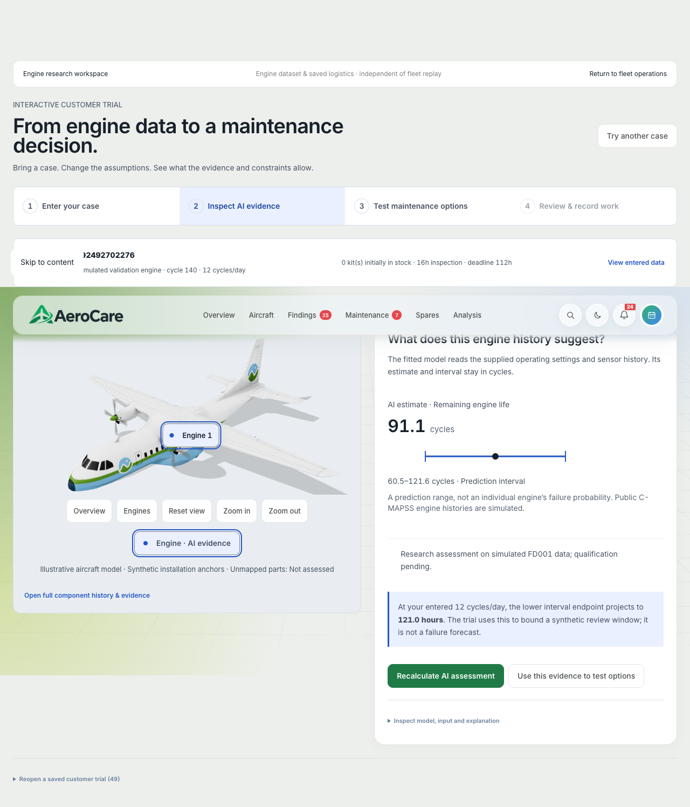
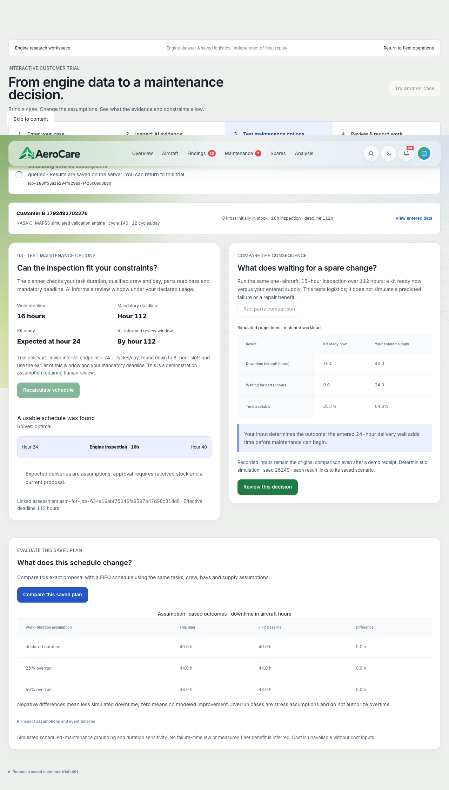
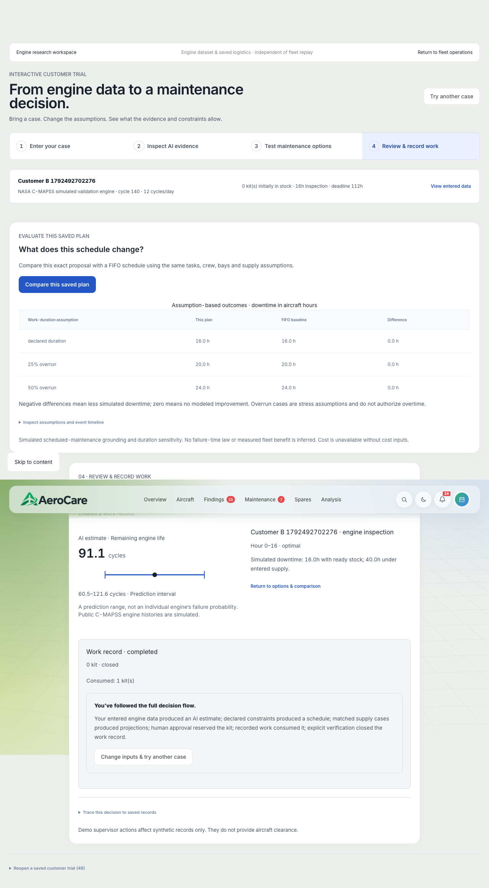

# Evidence to completed work: guided maintenance walkthrough

These are **retained historical local captures**, copied from the earlier `artifacts/ui-flow`
verification evidence. They are not a new execution on the public deployment. See the
[trial contract and verification record](../product/customer_trial.md). The 21 October local
capture attempt found the guided trial disabled, so fresh full-journey verification is pending.
All aircraft/logistics inputs in this example are demonstrator data.

## 1. Inspect the evidence

Review the selected history cutoff, model estimate, uncertainty and source evidence before
considering maintenance. An estimate is not a confirmed fault or aircraft clearance.

## 2. Compare feasible options and parts assumptions

Calculate a schedule with the recorded resources and supply assumptions. Compare the saved plan
and supply scenario. Record receipt and replan before approval when the earlier proposal depends
on an expected part; do not silently treat expected supply as stock on hand.

## 3. Approve, record execution and verify completion

A human approves the current proposal, records work start and execution completion, then verifies
the inspection outcome. The underlying journey checks reservation consumption and saved history.
The screenshots illustrate the stages; the [browser test](../../apps/web/tests/e2e/customer-trial.spec.ts)
and retained verification record supply the assertions. This is not observed operational downtime saved.
