# AeroCare product gallery

Published in commit `0765bdb`, with captures prepared 21 October 2026. These captures come from the real
local application at `http://localhost:8080`, with a synthetic supervisor account, at source
revision `fd81d73`. They are not mockups or new public-deployment verification. The API's
runtime image revision was not independently matched to that source revision.

## Fleet dashboard

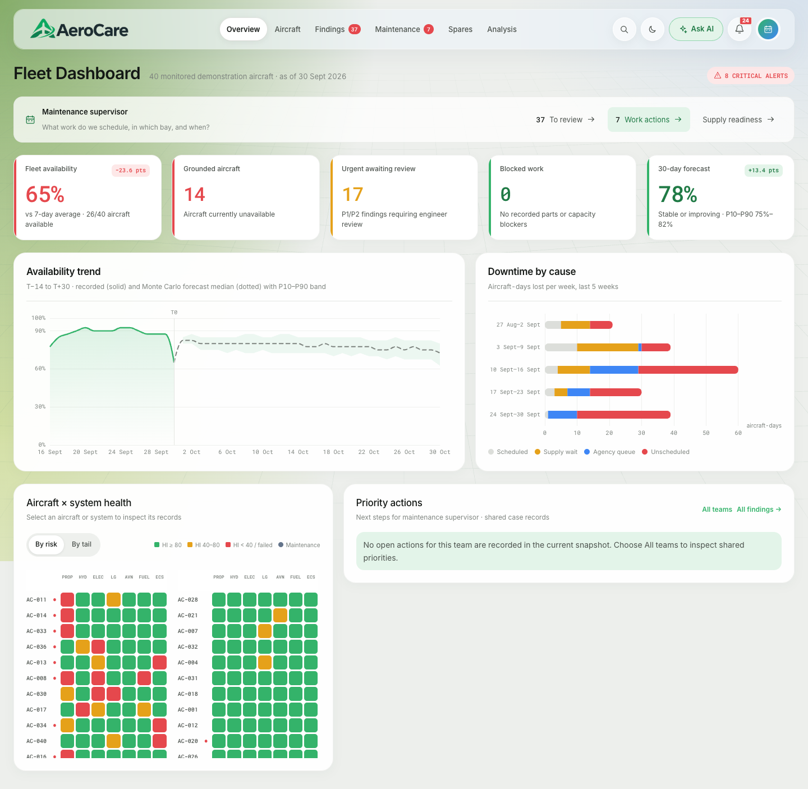

## Aircraft register

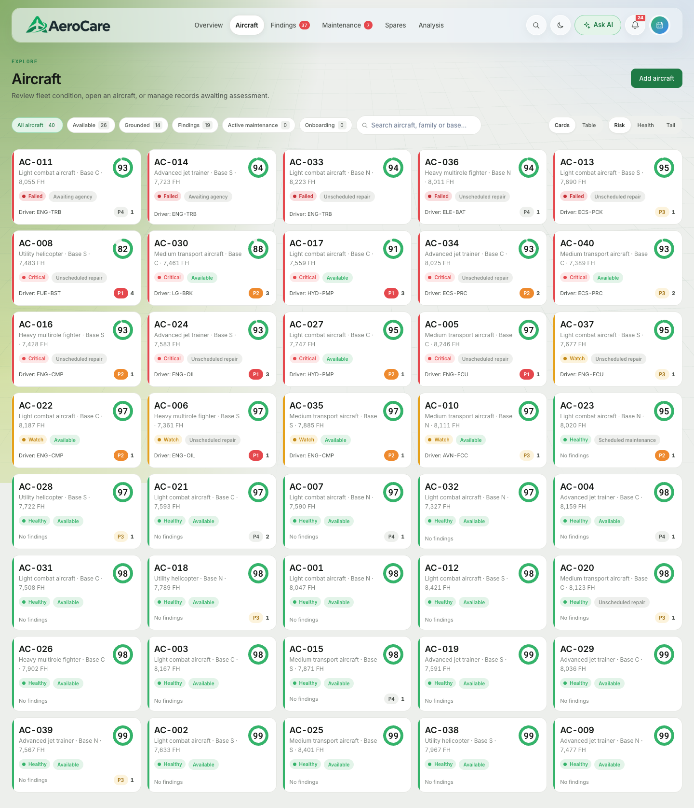

## Findings and maintenance

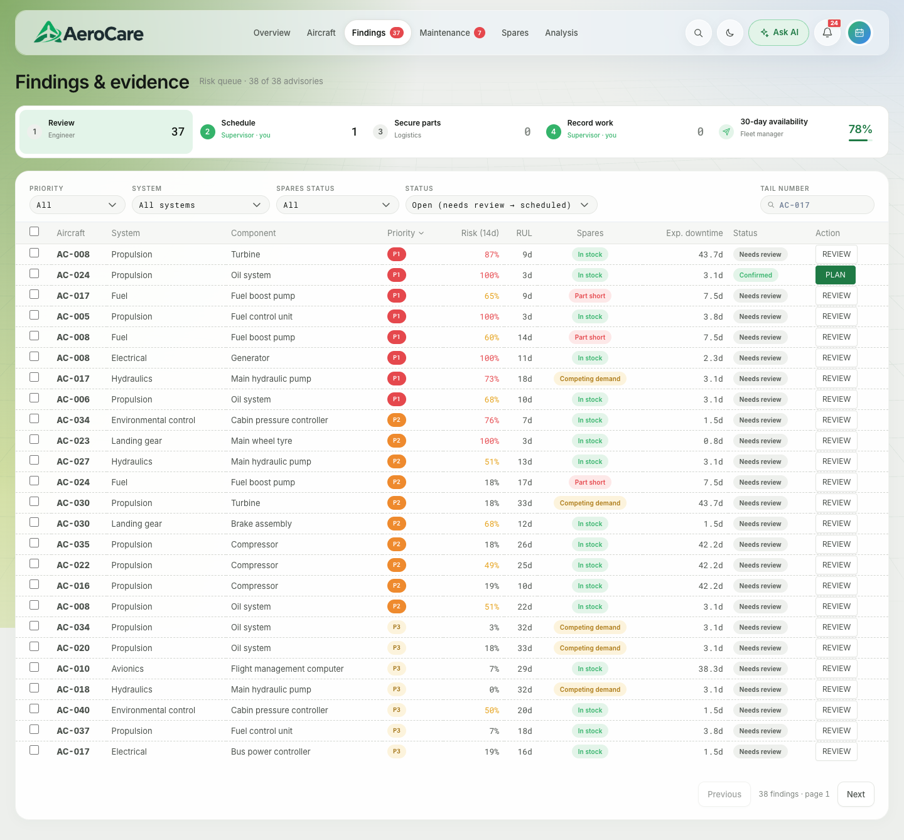

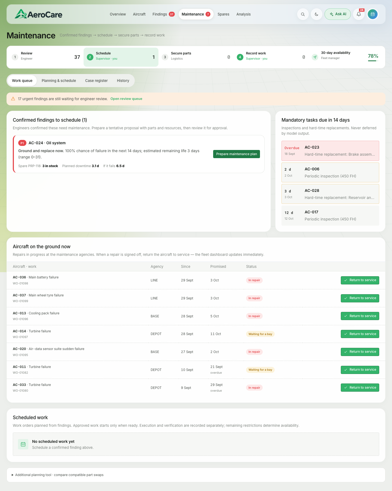

## Spares and analysis

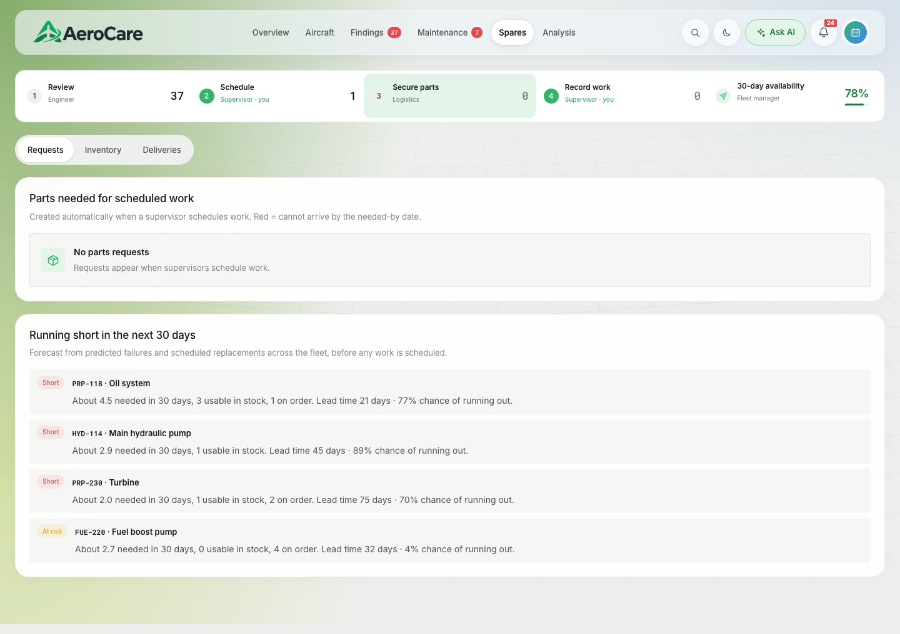

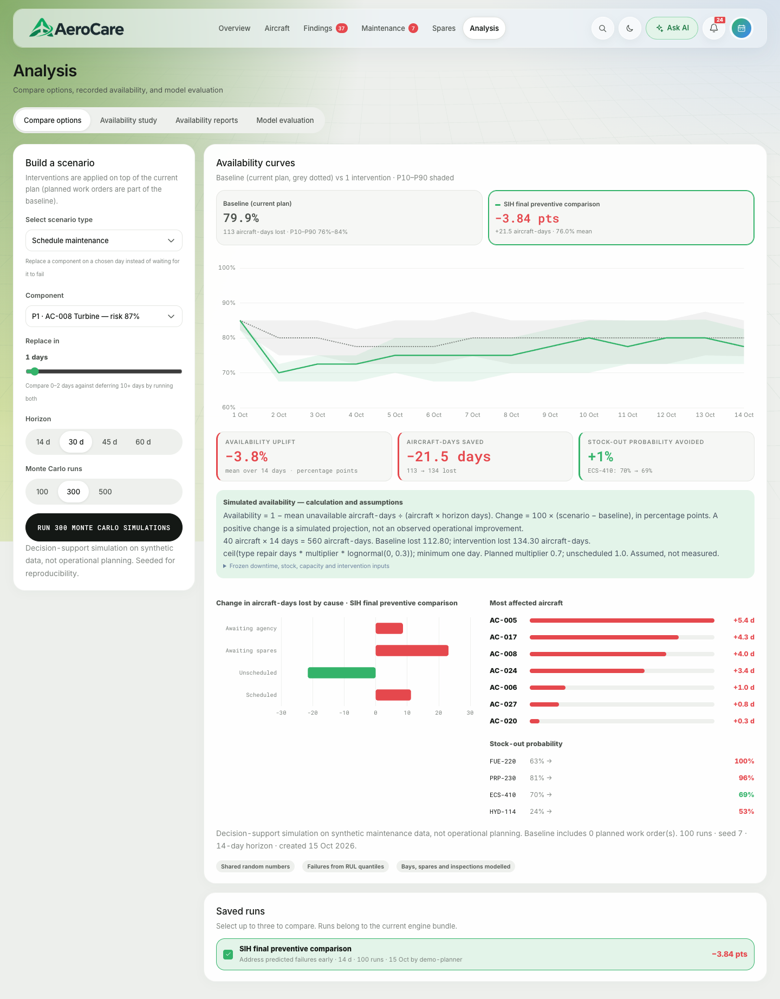

## Research workspace

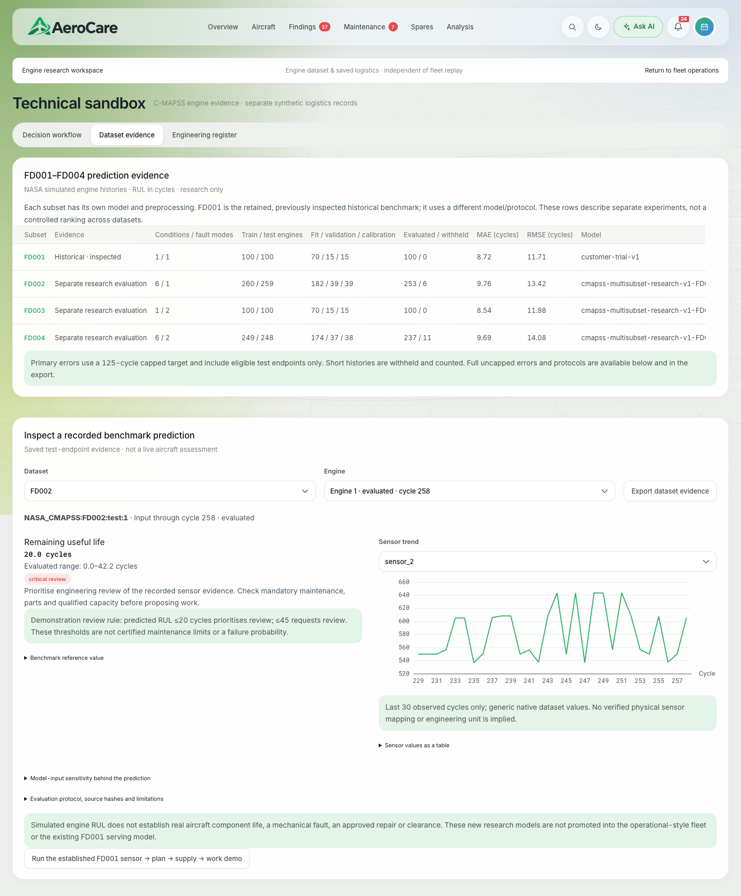

Research availability depends on installed evidence; a screenshot is not model qualification.

## Ask AI: actual record answers

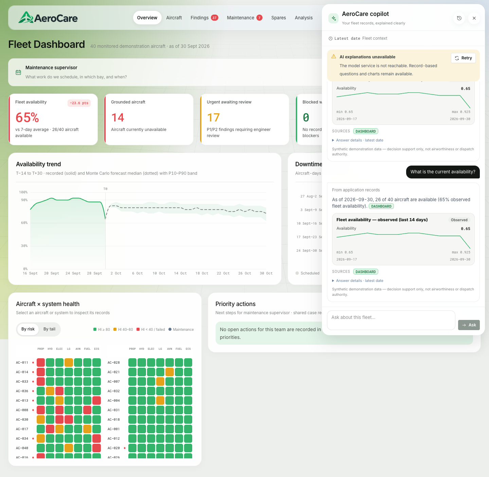

The visible model-unavailable notice is retained. These are service-backed record answers,
not a demonstration of generative Qwen inference. The owner reports that the separate deployed
generative assistant is fixed and responsive; the local notice does not describe its current state. The short recording and exact measurement
scope are linked in the [verification summary](../team/demo_verification_2026-10-21.md).

## Dark theme and mobile

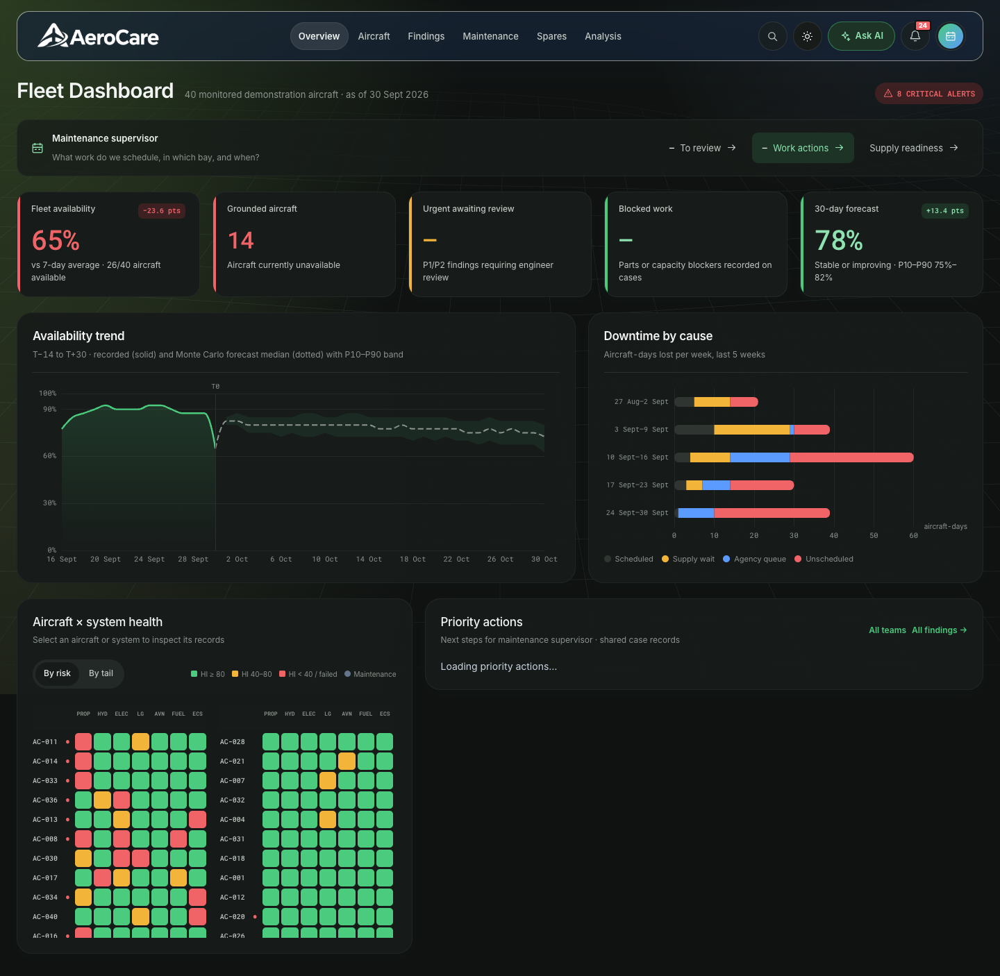

| Mobile light | Mobile dark |
|---|---|
| 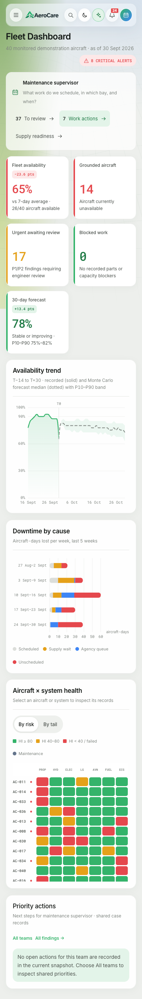 | 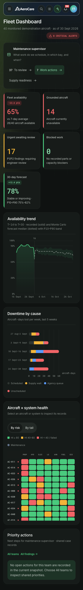 |

## Maintenance walkthrough

Follow the [annotated walkthrough](maintenance_walkthrough.md). It uses retained historical
captures because the current local installation disables the guided-trial entry.
